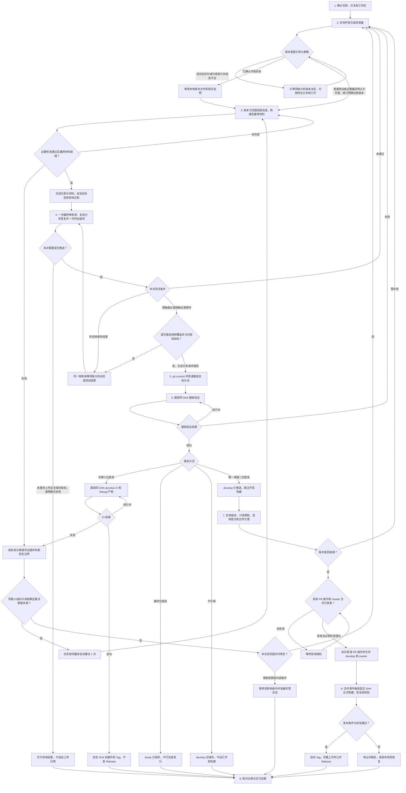

# EhReader 开发流程图

更新日期：2026-11-07。每次流程更改同步更新本图，细则见[开发任务流程](DEVELOPMENT_FLOW.md)。

各节点模型与推理等级见[节点推荐组合](DEVELOPMENT_FLOW.md#节点推荐组合)。默认沿用 GPT-6.1 Sol + High；第 3～6、8、9 节点可选 Medium，复杂问题再考虑 Astra + XHigh。由用户决定是否切换，不新增流程门禁。

本图位于仓库 .agents/docs，目录用途见[工作区目录约定](LOCAL_DEVELOPMENT.md#工作区目录约定)：本地 arm64-v8a 交付材料放 release，临时文件放 temp，废弃文件或目录回收到 trash。

- 第 2 阶段按[版本默认策略](DEVELOPMENT_FLOW.md#版本准备第-2-阶段)处理：普通改动及必要编译默认不升版，不等待形式确认；交付测试包但版本未说明时先确认，再生成最终包。
- 第 3 阶段可由[本地调度入口](LOCAL_DEVELOPMENT.md#本地任务调度入口)选择已有检查、ARM64 Debug 构建和材料整理，记录状态及缺项；入口本身不执行第 5 阶段提交推送或第 6 阶段 CI 跟踪。
- 返回第 2、3 阶段或继续同一任务时，按[结果复用规则](TESTING_STANDARDS.md#检查结果的复用与失效)复核输入、配置/工具及原证据，有效项复用、失效项重跑；正式 merge SHA 构建独立验收。
- 失败或取消按[恢复规则](DEVELOPMENT_FLOW.md#失败恢复与重新审核)记录；同输入的自动重试预算不因重复 run 重置。用户暂停后按当前输入和已有权限恢复，不跳过剩余步骤。
- 第 4 阶段使用[最终审核单](DEVELOPMENT_FLOW.md#最终审核单)一次列明测试安排与提交推送权限，图中两项判断用于复核条件，不代表连续提问。用户可一次答复“测试通过并允许推送”或“无需等待测试并允许推送”；已有充分明确指示直接复用，第 5 阶段才执行 commit。
- 第 5 阶段三段版本及不升版推送 develop，第四位升版推送已确认的 brody-版本号；分流细则见[发布规范](RELEASE_POLICY.md#按版本位置分流目标规则)。
- 第三位开发 CI 成功后创建 v版本号 Tag，不发 Release、不进入 master；第四位仅保存，不创建 Tag/Release，也不自动合并。
- 第一、二位升版跳过 develop/PR 构建，仅做合并前只读预检；具体 master 合并仍须用户批准，合并后执行完整正式 CI/CD。第 5～8 阶段按适用路径连续推进。
- 基础验证与打包分离；[本地实现/远端部署状态](RELEASE_POLICY.md#尚待实现的适配)分别记录。远端必需检查未调整前不得绕过现行门禁。
- 必要检查失败不得提交；测试通过、无需等待、允许推送三者含义分别记录，沉默不补足缺项。新包不沿用旧包测试通过结论；实质变更后更新审核单并重新确认受影响决定。
- 未要求上传且无已有保存权限时交付本地结果；明确仅本地的任务不进入第 5 阶段。权限依仓库规范，记录时点依开发流程：提交前写已知事实，提交后留外部证据，不为收尾自动循环提交。暂停或受阻同样保存真实状态。
