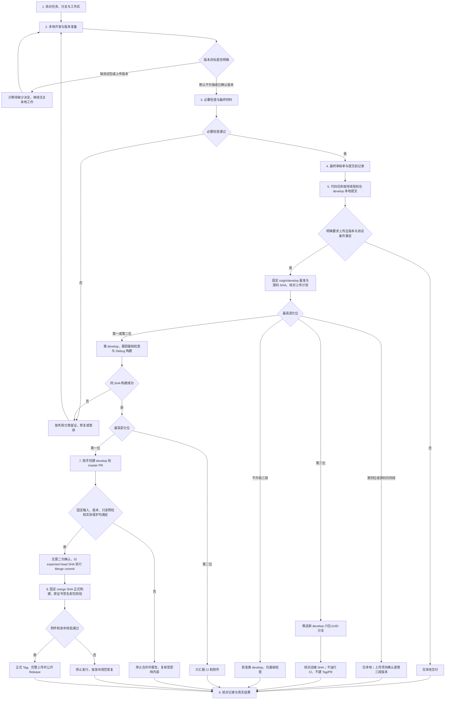

# EhReader 开发流程图

更新日期：2026-11-14。阶段见[开发流程](DEVELOPMENT_FLOW.md)，版本算法见[发布规范](RELEASE_POLICY.md)，权限见[仓库管理](REPOSITORY_WORKFLOW.md)。模型选择参考[节点推荐组合](DEVELOPMENT_FLOW.md#节点推荐组合)，不改变授权条件。

- 多位变化只取最左侧变化位；右侧允许改变，第四位仍仅本地，上传前三段须合法提升，安装编号独立递增。
- 第一位的版本确认与本次明确上传覆盖助手连续创建 PR、Merge commit 和发布验收，不再要求二次合并批准；CI 成功不补足尚未取得的上传许可。
- 第二位只构建并汇报，第三位只保存新临时分支且没有任何远端 CI，第四位只在本地按需 ARM64 Debug；上述路径都不新建开发 Tag。
- 本地必要检查不因远端不运行 CI 而免除；失败、取消、NO-SOURCE、未运行分别记录。复用与恢复见开发流程，不绕过保护或强推。
- 当前任务仅本地适配，部署状态见[适配清单](RELEASE_POLICY.md#尚待实现的适配)。提交前写已知记录，提交后 SHA/CI 留 temp 或 CI summary，不循环提交。
